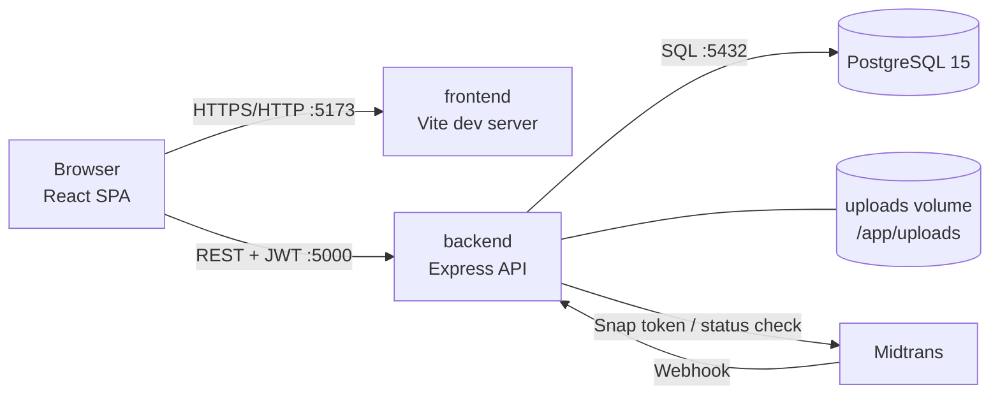
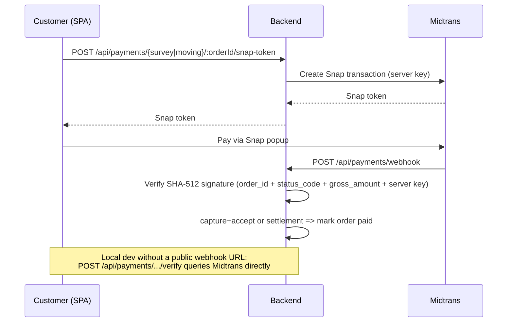

# MyKost

**A two-sided marketplace for on-site kost (boarding house) surveys and household moving services in Indonesia.**
MyKost connects customers with verified surveyors and movers, collects payment through Midtrans, and settles each completed job to the worker's in-app wallet after a platform commission.

> **Documentation baseline:** written against repository commit `e9410f8`. Sections marked **(carried over)** come from the previous README and were not re-audited against code; everything else was checked against the source.

---

## Table of contents

1. [Executive summary](#1-executive-summary)
2. [Product scope](#2-product-scope)
3. [System architecture](#3-system-architecture)
4. [Domain model and business rules](#4-domain-model-and-business-rules)
5. [Technology stack and rationale](#5-technology-stack-and-rationale)
6. [Getting started](#6-getting-started)
7. [Configuration reference](#7-configuration-reference)
8. [API reference](#8-api-reference)
9. [Security posture](#9-security-posture)
10. [Known limitations and risk register](#10-known-limitations-and-risk-register)
11. [Production readiness roadmap](#11-production-readiness-roadmap)
12. [Operations](#12-operations)
13. [Testing](#13-testing)
14. [Development workflow](#14-development-workflow)
15. [Troubleshooting](#15-troubleshooting)
16. [Ownership and license](#16-ownership-and-license)

---

## 1. Executive summary

### Problem
Prospective tenants often rent a kost without seeing it, and relocating between cities involves unvetted, informally priced movers. Both services depend on trust and on proof that work was actually done.

### Solution
MyKost is a single platform with two service lines:

| Service line | Customer gets | Worker does |
|---|---|---|
| **Survey kost** | A verified on-site report with photos for a fixed fee | Visits the property, submits notes and up to 10 photos |
| **Moving (jasa pindahan)** | A transparent, server-calculated price before paying | Picks up the job, moves the goods, uploads condition-proof photos at pickup and delivery |

### Business model
- Customers pay per order through **Midtrans Snap**.
- On completion the platform retains a **commission (default 10%)**, and the net amount is credited to the worker's wallet.
- Workers request withdrawals from the wallet (minimum Rp 10.000).

### Key design bets
- **Universal account:** one login can hold customer, surveyor, and mover capabilities.
- **Server-authoritative pricing:** clients never submit prices.
- **Evidence-first fulfilment:** photo proof protects both customer and worker in disputes.

---

## 2. Product scope

### 2.1 Actors

| Actor | How obtained | Primary capabilities |
|---|---|---|
| **Customer** | Every account | Order surveys and moves, pay, chat, review, complain |
| **Surveyor** | Registers as partner or applies later | Browse and accept survey jobs, submit results with photos, earn to wallet |
| **Mover** | Registers as partner or applies later | Browse and accept moving jobs, update status, upload evidence, earn to wallet |

### 2.2 Feature summary

| Area | Capability |
|---|---|
| Accounts | Register (customer), register as partner (mover/surveyor), login, profile, change password, apply for additional capability |
| Survey orders | Location via map picker, notes, optional attachments, fixed price **Rp 75.000** *(carried over)* |
| Moving orders | Pickup/dropoff, vehicle type, weight class, floor details, add-ons, price shown before payment |
| Payments | Midtrans Snap token, webhook with signature verification, manual verify endpoint for local development |
| Wallet | Balance, transaction ledger, withdrawal requests |
| Commission | Configurable platform rate, public rate endpoint for UI display |
| Communication | Per-order chat (polling), notification bell with unread counts |
| Trust and safety | Post-completion ratings (1 to 5), complaints with status tracking |

### 2.3 Out of scope (current release)
Real-time sockets, automated payout disbursement, admin back-office UI, multi-language UI, native mobile apps.

---

## 3. System architecture

### 3.1 Container topology



| Service | Image / build | Port | Notes |
|---|---|---|---|
| `postgres` | `postgres:15-alpine` | 5432 | Healthcheck via `pg_isready`; `schema.sql` and `seed.sql` mounted into `docker-entrypoint-initdb.d` |
| `backend` | `node:20-alpine` | 5000 | Waits for healthy DB; runs migrations at startup, aborts if they fail |
| `frontend` | `node:20-alpine` | 5173 | Vite dev server |

Named volumes: `postgres_data` (database) and `uploads_data` (user uploads).

### 3.2 Repository layout

```
MyKost/
├── docker-compose.yml
├── .env.example
├── backend/
│   ├── Dockerfile
│   └── src/
│       ├── server.js             # app bootstrap, route mounting, error handler
│       ├── routes/               # auth, users, surveyOrders, movingOrders, messages,
│       │                         # notifications, reviews, complaints, capabilities,
│       │                         # wallet, payments, config
│       ├── controllers/          # business logic per resource
│       ├── middleware/           # auth.js (authenticate, requireRole), upload.js (Multer)
│       ├── utils/                # movingPricing.js (+ test), commission.js, notify.js
│       └── db/
│           ├── schema.sql        # base schema, applied on first DB boot
│           ├── seed.sql          # three development accounts
│           ├── migrate.js        # runtime migration runner
│           ├── pool.js           # pg connection pool
│           ├── migrations/       # 002 to 006, tracked in schema_migrations
│           └── moving_v2_migration.sql   # legacy script outside migrations/
└── frontend/
    ├── Dockerfile
    └── src/
        ├── pages/                # landing, auth, onboarding, dashboards, order detail, wallet, checkout
        ├── components/           # Navbar, Chat, StatusTimeline, MapPicker, NotificationBell, ...
        ├── services/api.js       # Axios instance, JWT request interceptor, 401 handler
        ├── store/authStore.js    # Zustand auth and capability state
        ├── data/kotaList.js      # city list
        └── styles/
```

### 3.3 Payment flow



For Midtrans to reach the webhook in development, expose the backend through a tunnel and set the notification URL in the Midtrans dashboard to `/api/payments/webhook`. Without a tunnel, use the `verify` endpoints.

### 3.4 Data model overview

| Domain | Tables |
|---|---|
| Identity | `users`, `user_capabilities`, `mover_profiles`, `surveyor_profiles` |
| Survey | `survey_orders`, `order_status_history`, `survey_results`, `survey_result_photos` |
| Moving | `vehicle_types`, `moving_orders`, `moving_order_status_history`, `driver_reports` |
| Money | `user_wallets`, `withdrawals`, wallet transaction ledger |
| Platform | `schema_migrations` and supporting tables added by migrations 002 to 006 |

Primary keys are UUIDs to prevent sequential-ID enumeration. The full definition is in `backend/src/db/schema.sql` and `backend/src/db/migrations/`.

---

## 4. Domain model and business rules

### 4.1 Universal account and capabilities
Every user receives an active `customer` capability. `mover` and `surveyor` are additional rows in `user_capabilities` with a `status`. Registering through the partner flow grants the capability immediately; existing users can apply later. Route protection uses `requireRole('user' | 'agent' | 'mover')`, which maps legacy roles to capabilities.

### 4.2 Order lifecycles *(carried over)*

```
Survey:  pending_payment -> finding_agent -> assigned -> result_submitted -> completed
Moving:  DRAFT -> PENDING_PAYMENT -> ACCEPTED -> ON_GOING -> COMPLETED
```
Status changes are recorded in the corresponding history table.

### 4.3 Moving price formula *(carried over; unit-tested)*

```
base = distance_km x vehicle_rate        (Rp 2.700 / 13.000 / 20.000 per km)
     + door-to-door add-on               Rp 20.000
     + extra helper                      Rp 75.000
     + high floor without lift           Rp 20.000
     + heavy items                       Rp 40.000
     + round trip                        50% of subtotal
minimum charge                           Rp 30.000
rounded to nearest                       Rp 5.000
```
The formula is deterministic and lives in `utils/movingPricing.js`; it is the single source of truth.

### 4.4 Commission and wallet
- `commission = round(gross x rate)`, `net = gross - commission`. Rate defaults to `0.10`.
- Withdrawals require `amount >= 10.000`, a destination type (`bank_transfer` or `e_wallet`), name, and number. The balance check and debit run in one transaction using `SELECT ... FOR UPDATE` to prevent double-spend under concurrent requests.
- Withdrawals are tracked with `pending` and `processing` states.

### 4.5 Key design decisions and trade-offs

| Decision | Rationale | Trade-off |
|---|---|---|
| Universal account | Workers are also customers; avoids duplicate identities | Dual role model (legacy `role` plus capabilities) adds complexity, see risk R4 |
| Server-side pricing | Prevents tampering | Pricing changes require a deploy |
| Polling chat (15 s) | No persistent connection layer | Latency, request volume grows linearly with active chats |
| Midtrans Snap | Card and wallet data stays with the payment provider | Vendor dependency; webhook reachability required |
| UUID keys | No enumeration | Slightly larger indexes |
| Migrations at boot | Zero-touch local setup | Unsafe with multiple replicas, see risk R8 |

---

## 5. Technology stack and rationale

| Layer | Technology | Why |
|---|---|---|
| Frontend | React 18, Vite 5, React Router 6, Zustand, Axios | Fast iteration, small state footprint |
| Maps | Leaflet, react-leaflet | Open source, no API key for the library itself |
| Backend | Node.js 20, Express 4, Joi, express-async-errors | Simple, widely understood |
| Database | PostgreSQL 15 | Transactions and row locks needed for wallet integrity |
| Auth | JWT (`jsonwebtoken`, 7-day expiry), `bcryptjs` | Stateless API |
| Payments | Midtrans Snap | Local payment methods in Indonesia |
| Uploads | Multer (disk storage) | Simple, but see risk R3 |
| Abuse control | `express-rate-limit` | Applied to auth endpoints |
| Packaging | Docker Compose | One-command local environment |

---

## 6. Getting started

### 6.1 Prerequisites
- Docker Desktop with Compose v2
- Free host ports: **5173** (frontend), **5000** (backend), **5432** (PostgreSQL)
- A Midtrans **sandbox** account if you want to exercise payments

No local Node.js or PostgreSQL is required.

### 6.2 Setup

```bash
git clone https://github.com/jollyscenery/mykost.git
cd mykost
cp .env.example .env        # Windows PowerShell: Copy-Item .env.example .env
```

Edit `.env`:
1. Set `POSTGRES_PASSWORD` to a real password. Compose refuses to start without it.
2. Set `JWT_SECRET` to a random string of at least 32 characters, for example `openssl rand -hex 32`. Compose refuses to start without it.
3. Fill the Midtrans sandbox keys (`MIDTRANS_SERVER_KEY`, `VITE_MIDTRANS_CLIENT_KEY`) to enable payments. Without them, ordering works but checkout does not.

```bash
docker-compose up --build
```

| Service | URL |
|---|---|
| Frontend | http://localhost:5173 |
| Backend API | http://localhost:5000 |
| Liveness check | http://localhost:5000/api/health |

### 6.3 Verify the installation

```bash
curl http://localhost:5000/api/health          # {"status":"ok"}
docker-compose logs backend | grep migrate     # migrations applied on first boot
```
Then sign in with a test account below.

### 6.4 Development accounts

All use the password `password123`. They are created by `seed.sql` on first database boot.

| Role | Email |
|---|---|
| Customer | user@test.com |
| Surveyor | agent@test.com |
| Mover | mover@test.com |

> These credentials are public knowledge. Never run the seed script against a shared, staging, or production database (risk R2).

### 6.5 Stop and reset

```bash
docker-compose down                         # stop, keep data
docker-compose down -v && docker-compose up --build   # wipe DB and uploads, re-run schema and seed
```
`schema.sql` and `seed.sql` run only on an empty database volume. After changing either file, reset with `-v`.

---

## 7. Configuration reference

| Variable | Used by | Default | Required | Description |
|---|---|---|---|---|
| `POSTGRES_USER` | postgres, backend | `mykost_user` | No | Database user |
| `POSTGRES_PASSWORD` | postgres, backend | none | **Yes** | Database password |
| `POSTGRES_DB` | postgres, backend | `mykost_db` | No | Database name |
| `JWT_SECRET` | backend | none | **Yes** | HMAC secret for tokens |
| `VITE_API_URL` | frontend | `http://localhost:5000` | No | Public backend URL as seen by the browser |
| `MIDTRANS_SERVER_KEY` | backend | empty | For payments | Midtrans server key |
| `MIDTRANS_ENV` | backend | `sandbox` | No | `sandbox` or `production` |
| `VITE_MIDTRANS_CLIENT_KEY` | frontend | empty | For payments | Midtrans client key |
| `VITE_MIDTRANS_ENV` | frontend | `sandbox` | No | `sandbox` or `production` |
| `PLATFORM_COMMISSION_RATE` | backend | `0.10` | No | Commission fraction. **Not forwarded by `docker-compose.yml` and absent from `.env.example`; see risk R9** |
| `NODE_ENV`, `PORT`, `DB_HOST`, `DB_PORT`, `DB_USER`, `DB_PASSWORD`, `DB_NAME` | backend | set in compose | No | Injected by Compose, rarely changed |

Note: `.env.example` also lists `MIDTRANS_CLIENT_KEY`, which the Compose file does not pass to any service.

---

## 8. API reference

### 8.1 Conventions
- Base URL: `http://localhost:5000`. All routes are under `/api`.
- Auth: `Authorization: Bearer <JWT>` unless marked public.
- Errors: JSON `{ "error": "message" }` with an appropriate HTTP status (400 validation, 401 unauthenticated, 403 forbidden, 500 unexpected).
- Auth endpoints are rate limited to **20 requests per 15 minutes per client IP**.
- Uploads accept `jpeg`, `png`, `webp`, maximum **5 MB per file**.

### 8.2 Endpoints

The table below is a summary. The source of truth is `backend/src/routes/`.

**Identity**

| Method | Path | Auth | Description |
|---|---|---|---|
| POST | /api/auth/register | public | Create customer account |
| POST | /api/auth/register-mitra | public | Create partner account (`account_type`: `mover` or `surveyor`) |
| POST | /api/auth/login | public | Returns JWT, user, capabilities |
| GET | /api/auth/me | any | Current user |
| POST | /api/auth/logout | public | No-op acknowledgement; the token is **not** invalidated server-side |
| GET / PUT | /api/users/profile | any | Read or update profile |
| POST | /api/users/change-password | any | Change password |
| GET / POST | /api/me/capabilities | any | List capabilities / apply for a new one |

**Survey orders**

| Method | Path | Auth | Description |
|---|---|---|---|
| POST | /api/survey-orders | customer | Create order |
| GET | /api/survey-orders | customer | List own orders |
| GET | /api/survey-orders/:id | customer, surveyor | Detail with history |
| GET | /api/survey-orders/available | surveyor | Open jobs |
| POST | /api/survey-orders/:id/accept | surveyor | Accept job |
| PUT | /api/survey-orders/:id/status | surveyor | Update status |
| POST | /api/survey-orders/:id/result | surveyor | Submit result and photos |

**Moving orders**

| Method | Path | Auth | Description |
|---|---|---|---|
| POST | /api/moving-orders | customer | Create order (price computed server-side) |
| GET | /api/moving-orders | customer | List own orders |
| GET | /api/moving-orders/:id | customer, mover | Detail |
| GET | /api/moving-orders/available | mover | Open jobs |
| POST | /api/moving-orders/:id/accept | mover | Accept job |
| PUT | /api/moving-orders/:id/status | mover | Update status |
| POST | /api/moving-orders/:id/evidence | mover | Upload condition photos |

**Payments, wallet, configuration**

| Method | Path | Auth | Description |
|---|---|---|---|
| POST | /api/payments/survey/:orderId/snap-token | any | Create Snap token |
| POST | /api/payments/moving/:orderId/snap-token | any | Create Snap token |
| POST | /api/payments/survey/:orderId/verify | any | Verify payment against Midtrans (dev fallback) |
| POST | /api/payments/moving/:orderId/verify | any | Verify payment against Midtrans (dev fallback) |
| POST | /api/payments/webhook | signature | Midtrans notification, SHA-512 signature checked |
| GET | /api/wallet | any | Balance and pending withdrawals |
| GET | /api/wallet/transactions | any | Ledger (page size 10 to 50) |
| POST | /api/wallet/withdraw | any | Request withdrawal |
| GET | /api/config/commission-rate | public | Current commission rate |

**Collaboration and trust**

| Method | Path | Auth | Description |
|---|---|---|---|
| GET / POST | /api/messages/:orderId | any | Read or send order chat |
| GET | /api/messages/unread | any | Unread count |
| GET | /api/notifications | any | Notifications |
| PUT | /api/notifications/:id/read | any | Mark read |
| POST | /api/reviews | any | Submit rating |
| GET / POST | /api/complaints | any | List own / file complaint |

**Operations**

| Method | Path | Auth | Description |
|---|---|---|---|
| GET | /api/health | public | Process liveness only (does not check the database) |
| GET | /uploads/* | **public** | Static uploaded files, see risk R3 |

---

## 9. Security posture

### 9.1 Controls in place

| Control | Evidence |
|---|---|
| Password hashing | `bcryptjs` |
| Input validation | Joi schemas on auth and wallet inputs |
| SQL injection resistance | Parameterized queries via `pg` |
| Brute-force throttling | Rate limit on register, register-mitra, login |
| Payment authenticity | Webhook signature verified with SHA-512 before any state change |
| Financial consistency | Wallet debit in a transaction with row lock |
| Price integrity | Server-side calculation, client cannot set price |
| Upload hygiene | MIME allow-list, 5 MB cap, randomized filenames |
| Secret hygiene | `.env` git-ignored; Compose fails fast when `POSTGRES_PASSWORD` or `JWT_SECRET` is missing |
| Session handling in UI | Axios clears the token and redirects to login on any 401 |

### 9.2 Gaps
See the risk register. The most important: wildcard CORS, publicly readable uploads, long-lived non-revocable tokens in `localStorage`, and a seed script with known credentials.

---

## 10. Known limitations and risk register

Severity reflects impact if deployed publicly as-is.

| ID | Severity | Finding | Recommended action |
|---|---|---|---|
| R1 | **High** | CORS is `origin: '*'`. Any website can call the API from a user's browser (tokens live in `localStorage`, so the practical risk is lower than with cookies, but it removes a defence layer). | Allow-list the production frontend origin via an environment variable. |
| R2 | **High** | `seed.sql` creates three accounts with the public password `password123` and runs automatically on any empty database. | Split into `seed.dev.sql`, mount it only in a development Compose override, never in staging or production. |
| R3 | **High** | `/uploads` is served by `express.static` with no authentication. Moving-evidence and survey photos are therefore readable by anyone with the URL. Filenames are `Date.now()` plus 7 base-36 characters, which is not cryptographically unguessable. The MIME check trusts the client-supplied `Content-Type` and does not inspect file contents. | Serve files through an authenticated endpoint or signed URLs, move to object storage (S3-compatible), validate magic bytes, generate filenames with `crypto.randomUUID()`. |
| R4 | Medium | JWT lifetime is 7 days, stored in `localStorage` (exposed to XSS), `/auth/logout` does not revoke anything, and `requireRole` accepts the role claim in the token **without** a database check on its fast path. A revoked capability or role change stays effective until the token expires. | Shorten access tokens (15 to 30 min) with refresh tokens in `httpOnly` cookies, add a revocation or version claim, and always check capabilities in the database for sensitive actions. |
| R5 | Medium | Password policy is minimum 6 characters, no MFA. Rate limiting is per IP and applies to auth routes only; behind a reverse proxy it needs `trust proxy` configured or all users share one bucket. | Raise the minimum to 10 to 12 characters, add breached-password checks, rate-limit wallet and payment endpoints, configure proxy trust. |
| R6 | Medium | No `helmet` or equivalent security headers, no TLS termination in the stack, no explicit body size limits beyond defaults. | Add `helmet`, terminate TLS at a reverse proxy, set explicit JSON and upload limits. |
| R7 | Medium | Containers are development-grade: `nodemon` and the Vite dev server run in every container, source is bind-mounted, images run as root and use `npm install` rather than `npm ci`, and PostgreSQL port 5432 is published to the host. Compose also declares the obsolete `version` key. | Create production Dockerfiles (multi-stage, non-root, `npm ci --omit=dev`, static frontend build behind nginx), do not publish the DB port, use a Compose override for development. |
| R8 | Medium | Schema is managed by two mechanisms: `schema.sql` on first boot and runtime migrations on every start. Migrations begin at `002` (there is no `001`), and `moving_v2_migration.sql` sits outside `migrations/` and is not idempotent. Running migrations at application boot is unsafe with more than one replica. | Consolidate into a single baseline plus numbered migrations, run migrations as a separate release step, adopt a migration tool with locking. |
| R9 | Medium | `PLATFORM_COMMISSION_RATE` is read by the backend but is neither listed in `.env.example` nor forwarded by `docker-compose.yml`. Setting it in `.env` silently has no effect, so the rate is always 10%. | Add it to both files and document the accepted range. |
| R10 | Medium | Test coverage is one unit-test file (pricing). Payment webhook, wallet withdrawal, commission, and role checks have no automated tests, although they handle money and access control. | Add integration tests (API plus real PostgreSQL) for those flows before any further feature work. |
| R11 | Medium | Withdrawals are recorded as `pending` and `processing`, but this README does not document an automated payout or reconciliation process. | Define the operational payout procedure and reconciliation report; consider Midtrans Iris or a bank API if automation is required. |
| R12 | Low | `/api/health` reports process liveness only. | Add a readiness endpoint that checks database connectivity. |
| R13 | Low | Chat polls every 15 seconds per open conversation. | Acceptable at pilot scale; plan WebSocket or Server-Sent Events if concurrent users grow. |
| R14 | Low | Personal data (name, email, phone, locations) is stored. | Assess obligations under Indonesia's Personal Data Protection Law (UU No. 27 Tahun 2022): privacy notice, retention policy, deletion path. |

---

## 11. Production readiness roadmap

**Phase 0: blockers before any public deployment**
- [ ] R1 CORS allow-list
- [ ] R2 remove seed accounts from non-dev environments
- [ ] R3 protect uploads, validate content, random filenames
- [ ] R7 production images, unpublished DB port
- [ ] TLS in front of the API and frontend
- [ ] Switch Midtrans to production keys only after the above

**Phase 1: hardening**
- [ ] R4 token lifecycle and revocation
- [ ] R5 password policy, broader rate limiting
- [ ] R6 security headers
- [ ] R8 migration consolidation and release-time execution
- [ ] R9 commission configuration wired end to end
- [ ] R10 integration tests for money and RBAC
- [ ] Structured logging, error tracking, uptime alerts

**Phase 2: scale and operability**
- [ ] R11 payout automation and reconciliation
- [ ] R12 readiness probe, R13 real-time messaging
- [ ] CI pipeline (lint, test, image build, dependency and image scanning)
- [ ] Automated database backups with a tested restore
- [ ] R14 privacy and data-retention programme

---

## 12. Operations

| Topic | Current state | Guidance |
|---|---|---|
| Migrations | Run automatically at backend start; applied names stored in `schema_migrations`; each file runs inside a transaction; startup aborts on failure | In production run as an explicit release step |
| Backups | None configured | Back up the `postgres_data` volume with a scheduled `pg_dump` and test restores; back up uploads separately |
| Uploads | Local Docker volume `uploads_data` | Single-node only; move to object storage before scaling out |
| Logging | `console.log` and `console.error` | Ship to a log platform; avoid logging payment payloads |
| Health | `GET /api/health` | Use for liveness only (see R12) |
| Secrets | `.env` file | Use a secret manager in production; rotate any value that was ever shared in chat, email, or a screenshot |

---

## 13. Testing

```bash
docker-compose exec backend npm test
```
Runs `node --test src/**/*.test.js`. At present only `utils/movingPricing.test.js` exists. See R10 for the recommended expansion.

Manual smoke test after setup:
1. Log in as `user@test.com`, create a moving order, confirm the displayed price matches the formula.
2. Pay with a Midtrans sandbox method, then confirm the order status changes (via webhook or the `verify` endpoint).
3. Log in as `mover@test.com`, accept the job, advance statuses, upload evidence.
4. Complete the order, then check the mover's wallet shows the net amount after commission.
5. Request a withdrawal below Rp 10.000 and confirm it is rejected.

---

## 14. Development workflow

- **Branches:** `main` is the integration branch; use `feat/<topic>` and `fix/<topic>` branches and merge through pull requests with at least one reviewer.
- **Commits:** Conventional Commit style, as already used in history (`feat:`, `fix:`).
- **Never commit:** `.env`, uploaded files, database dumps, `node_modules`. `.gitignore` already covers `.env`, `node_modules/`, `dist/`, and `*.log`.
- **Definition of done:** feature works in Docker from a clean volume, tests added for any money or permission logic, no new secrets in the diff, README and `.env.example` updated when configuration changes.

---

## 15. Troubleshooting

| Symptom | Likely cause | Fix |
|---|---|---|
| `POSTGRES_PASSWORD is required` or `JWT_SECRET is required` on `up` | `.env` missing or variable empty | Create `.env` from `.env.example` and fill both |
| `port is already allocated` (5173, 5000, 5432) | Another process uses the port, often a local PostgreSQL on 5432 | Stop the other process or change the host-side port in Compose |
| Schema or seed changes have no effect | `initdb` scripts run only on an empty volume | `docker-compose down -v && docker-compose up --build` |
| Backend exits with `Migration failed, aborting startup` | A migration SQL error, or the database is in a partially migrated state | Read `docker-compose logs backend`; fix the SQL; reset the volume in development |
| Browser calls fail or point to the wrong host | `VITE_API_URL` incorrect | Set it to the URL the **browser** can reach, rebuild the frontend |
| Payment succeeds in Midtrans but the order stays unpaid | Webhook cannot reach `localhost` | Use a tunnel and set the notification URL, or call the `verify` endpoint |
| Commission always 10% | R9: variable is not forwarded | Add `PLATFORM_COMMISSION_RATE` to the backend `environment` block in Compose |
| Redirected to `/login` repeatedly | Token expired or secret changed | Log in again; the UI clears the token on any 401 |

---

## 16. Ownership and license

- **Maintainers:** *to be filled in by the team.*
- **License:** *not specified.* Add a `LICENSE` file before external distribution; without one, all rights are reserved by default.
